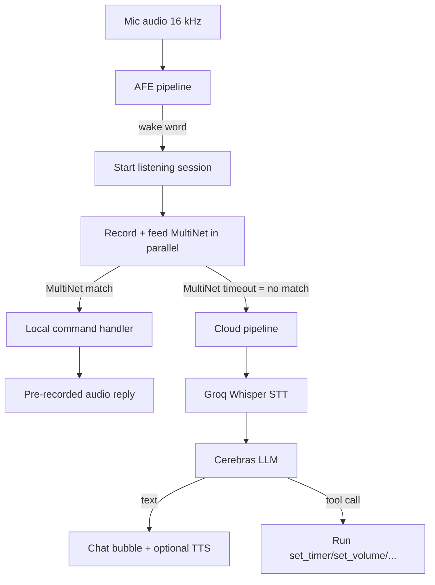
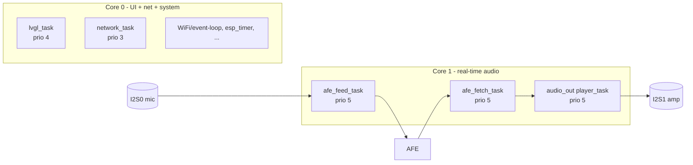
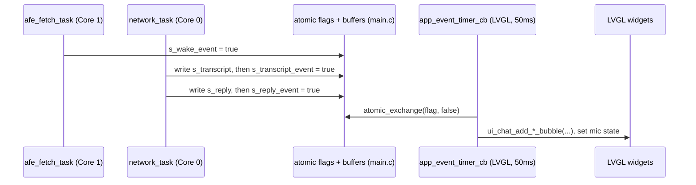
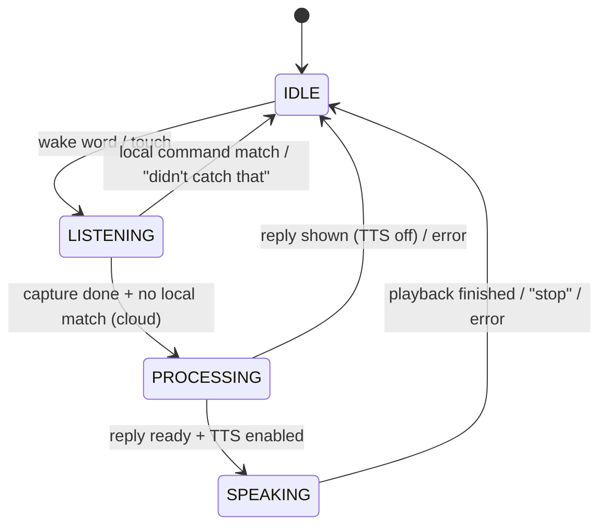

# 2. Architecture

This chapter explains how MiniLingo is structured at runtime: the hybrid
local/cloud split, the concurrent tasks and how they communicate, the memory
budget that shapes everything, and the flash layout.

## The hybrid principle

Every utterance is classified as **local** or **cloud** as early as possible:

The key insight: after the wake word, the **recorder** and the **MultiNet
command recognizer** run on the *same* audio frames simultaneously. If MultiNet
matches a known phrase, it's a local command and the recording is thrown away.
If MultiNet times out without a match, the recording (already captured) is sent
to the cloud. This is why the common cases (timer, volume) are instant and free
while arbitrary questions still work.

Why this split exists at all — latency, free-tier quotas, and keeping ordinary
commands offline — is argued in [06-design-decisions.md](06-design-decisions.md).

## Task model

Everything is a FreeRTOS task pinned to one of the two cores. **Core 1** is
dedicated to the real-time audio path; **Core 0** runs the UI, networking, and
system tasks.

| Task | Core | Prio | Stack | Created in | Job |
|---|---|---|---|---|---|
| `afe_feed_task` | 1 | 5 | 4 KB | [afe_pipeline.c](../main/speech/afe_pipeline.c) | read mic (I2S0) → feed AFE |
| `afe_fetch_task` | 1 | 5 | 8 KB | [afe_pipeline.c](../main/speech/afe_pipeline.c) | AFE results → wake word, recorder, MultiNet |
| `audio_out` player | 1 | 5 | 4 KB | [canned_audio.c](../main/local/canned_audio.c) | play WAVs / PCM → amp (I2S1) |
| `lvgl_task` | 0 | 4 | 8 KB | [main.c](../main/main.c) | run LVGL, render the UI |
| `network_task` | 0 | 3 | 16 KB | [cloud.c](../main/network/cloud.c) | the cloud pipeline (STT→LLM→TTS) |
| event-loop, esp_timer, Wi-Fi | 0 | (system) | — | ESP-IDF | Wi-Fi events, timers |

The `afe_feed`/`afe_fetch` core and priority come from the AFE config
(`afe_perferred_core = 1`, `afe_perferred_priority = 5`).

## How the tasks communicate (thread boundaries)

This is the single most important thing to understand before editing. **LVGL is
not thread-safe**, so only `lvgl_task` may touch the UI. Every other task that
wants to change the screen instead sets an **atomic flag** (and writes a text
buffer *before* the flag). A 50 ms LVGL timer, `app_event_timer_cb` in
[main.c](../main/main.c), drains those flags and performs the actual UI updates
from within the LVGL task.

The flag set lives at the top of [main.c](../main/main.c): `s_wake_event`,
`s_processing_event`, `s_transcript_event`, `s_reply_event`, `s_speaking_event`,
`s_cloud_done_event`, `s_cloud_error_event`, `s_cmd_event`/`s_cmd_arg`,
`s_timer_done_event`, `s_too_quiet_event`, `s_wifi_event`. Each producer writes
any associated text buffer **first**, then stores the flag — so the pump never
reads a half-written buffer.

Three rules follow from this design:

1. **Audio/recorder/command callbacks run in `afe_fetch_task`** — they may not
   call LVGL. They set flags.
2. **Cloud results run in `network_task`** — same rule, they set flags.
3. **`esp_timer` callbacks** (kitchen timer done, Wi-Fi reconnect) run in the
   esp_timer task — same rule.

Work that *isn't* UI can be done directly from any task if the target is
thread-safe: `volume_set` (atomics), `kitchen_timer_start` (esp_timer +
atomics), and `canned_audio_play` (just enqueues) are all safe to call from the
network task — which is exactly what the cloud tool-calls do.

## The state machine

The conceptual states are **IDLE → LISTENING → PROCESSING → SPEAKING → IDLE**.
There is no central state object; the state is the combination of the flags
above plus three booleans the LVGL task keeps (`s_listening`, `s_processing`,
`s_speaking`). `update_state_text()` renders them into the status bar.

During **PROCESSING** and **SPEAKING** the pipeline is "busy"
(`cloud_is_busy()`), and the `afe_fetch_task` refuses new wake words — because
the Whisper upload is still reading from the single recording buffer, and a new
capture would overwrite it. During **SPEAKING**, MultiNet runs in a restricted
mode that only accepts "stop" (the mic hears the speaker; everything else would
be a false positive).

> Why the state lives in `main.c` flags rather than `state.c`: see
> [06-design-decisions.md](06-design-decisions.md). `state.c` holds only the
> conversation history.

## Memory budget

The ESP32-S3 has ~512 KB internal SRAM and 8 MB external PSRAM. The internal
SRAM is the scarce resource: esp-sr (WakeNet + MultiNet + AFE), the Wi-Fi
stack, task stacks, and the TLS handshake all want it. The whole design bends
around this:

- **Big buffers go to PSRAM** (`MALLOC_CAP_SPIRAM`): the recording buffer
  (~256 KB), the conversation history (~10 KB), the TTS response/PCM buffers
  (~2.5 MB, allocated lazily only when TTS is first used), the Whisper raw
  scratch.
- **mbedTLS allocates from PSRAM** (`CONFIG_MBEDTLS_EXTERNAL_MEM_ALLOC`): the
  ~50 KB TLS handshake did not fit in internal SRAM next to esp-sr.
- **Only one TLS connection at a time.** All cloud requests run sequentially in
  `network_task`; two concurrent handshakes would exhaust the heap.
- **Only one wake-word model loaded at a time.** All three character models are
  in flash, but loading all three at boot exhausted internal SRAM (the AFE task
  stacks failed to allocate → boot loop). Switching characters reboots and
  loads just the chosen one. See [07-lessons-learned.md](07-lessons-learned.md).
- **`CONFIG_SPIRAM_MALLOC_ALWAYSINTERNAL=16384`**: allocations ≤16 KB prefer
  internal RAM; larger ones fall to PSRAM by default.

Audio DMA is a related trap: enlarging the I2S-DMA buffer to smooth TTS
playback starved the TLS hardware-AES of internal RAM. Don't grow it; see the
streaming note in [08-status-and-roadmap.md](08-status-and-roadmap.md).

## Flash layout

Custom partition table, [partitions.csv](../partitions.csv), on 16 MB flash:

| Partition | Type | Size | Holds |
|---|---|---|---|
| `nvs` | data/nvs | 24 KB | Wi-Fi creds, API keys, active character, settings |
| `phy_init` | data/phy | 4 KB | RF calibration |
| `factory` | app | 3 MB | the firmware (~20 % free at last build) |
| `model` | data/spiffs | 5 MB | esp-sr models: 3 WakeNets + MultiNet7 |
| `storage` | data/spiffs | 1 MB | canned-audio WAVs |

The model and storage SPIFFS images are built and flashed alongside the app
(see [05-build-and-setup.md](05-build-and-setup.md)).

## Boot sequence

`app_main()` in [main.c](../main/main.c) wires everything up in this order:

1. `nvs_flash_init()` then `config_init()` — load runtime config from NVS
   (falls back to Kconfig defaults).
2. Restore the active character; set its **persona** (`llm_set_system_prompt`)
   and **TTS voice** (`tts_set_voice`).
3. LVGL + display + touch + UI; register UI callbacks; start `lvgl_task`.
4. `wifi_init()`; if no Wi-Fi is provisioned, auto-open the setup portal.
5. `cloud_init()` — starts `network_task` (before the audio pipeline, because
   the audio task calls into it).
6. Audio out + volume + canned audio + kitchen timer.
7. Load esp-sr models, init MultiNet **commands** (before the pipeline), then
   `afe_pipeline_init()` with only the active character's wake word — which
   starts `afe_feed_task` and `afe_fetch_task` and begins listening.

From here, read [03-request-lifecycle.md](03-request-lifecycle.md) to see a
single request flow through all of this.
