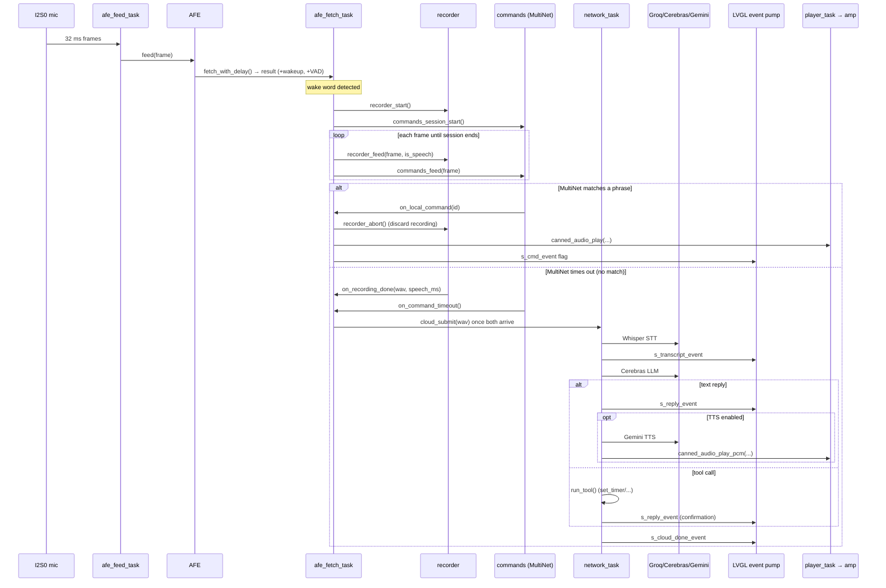

# 3. Request Lifecycle

This is the spine of the whole system: one trip from wake word to answer, with
every handoff between tasks named. Keep [02-architecture.md](02-architecture.md)
(task model + thread boundaries) next to this.

## The full picture



The rest of this chapter walks each stage with file references.

## 1. Always-on listening

`afe_feed_task` ([afe_pipeline.c](../main/speech/afe_pipeline.c)) reads ~32 ms
chunks from the mic ([audio_in.c](../main/drivers/audio_in.c), I2S0, 16 kHz,
32→16-bit with +12 dB shift) and hands them to the AFE. `afe_fetch_task` pulls
processed results back out. Each result carries cleaned audio, a `wakeup_state`,
and a `vad_state`.

A listening session also starts on a **touch** of the mic button:
`on_mic_button_clicked` → `afe_pipeline_request_listening()` sets an atomic flag
that `afe_fetch_task` consumes on its next frame (`wake_word_on_touch()`).

## 2. Wake word → start capture + recognition

When `wakeup_state == WAKENET_DETECTED` (or a touch is pending) *and* nothing is
already active and the cloud isn't busy, `afe_fetch_task`:

- calls `wake_word_on_detected()` → `on_wake_word()` in [main.c](../main/main.c),
  which resets the cloud-path state and sets `s_wake_event` (UI → "Listening…",
  red mic);
- starts the **recorder** (`recorder_start()`) and the **MultiNet session**
  (`commands_session_start()`).

From the *next* frame on, every frame goes to **both** the recorder and
MultiNet:

```c
commands_feed(res->data, samples);
recorder_feed(res->data, bytes, res->vad_state == VAD_SPEECH);
```

> The `vad_cache` (older buffered audio the AFE can prepend) is deliberately
> **not** used — it overlapped already-delivered frames and produced doubled
> phrase starts ("set set timer"). See
> [07-lessons-learned.md](07-lessons-learned.md).

## 3. The race: local command vs. cloud query

Two independent things can end the session — this is the routing decision.

**Local match.** MultiNet recognizes a phrase →
[commands.c](../main/speech/commands.c) `detect_chunk()` fires `on_local_command`
in [main.c](../main/main.c). It:
- checks the per-command minimum probability (short commands need ≥0.25; during
  SPEAKING, "stop" needs ≥0.30) — a rejected match keeps listening rather than
  ending the session;
- `recorder_abort()`s the recording (it was a command, not a question);
- runs the handler (start timer, change volume, …), plays the matching canned
  WAV, and sets `s_cmd_event` for the UI.

**No match → cloud.** Two events must both happen before upload, and they can
arrive in either order:
- `on_recording_done(wav, …, speech_ms, …)` — the recorder stopped after
  1.5 s of silence or hit the 8 s cap;
- `on_command_timeout()` — MultiNet gave up after 6 s with no match.

`submit_cloud_query()` fires only once **both** are in (`s_pending_wav` set
*and* `s_mn_timed_out`). The recorder stops at 1.5 s silence but MultiNet runs
to 6 s, so usually the WAV is waiting and the timeout triggers the upload; for
utterances longer than 6 s the order flips. Either way:
`cloud_submit()` → enqueue → `s_processing_event` (UI → "Processing…", orange).

> **Silence guard:** if `speech_ms < 1000`, the capture is discarded
> (`s_too_quiet_event` → "Didn't catch that" + error beep) and never uploaded.
> This stops Whisper from hallucinating sentences out of near-silence. The
> 1000 ms threshold accounts for ~600 ms of VAD "phantom speech" (wake-word
> reverb) measured on the device.

## 4. Cloud pipeline (network_task)

`network_task` in [cloud.c](../main/network/cloud.c) processes one job at a
time. TLS connections are strictly sequential — each request fully closes
before the next opens.

1. **Wi-Fi check** — not connected → `CLOUD_EVT_ERROR "No WiFi connection"`.
2. **STT** — `whisper_transcribe()` ([whisper.c](../main/network/whisper.c))
   uploads the WAV as multipart form-data to Groq, parses `text`. On success →
   `CLOUD_EVT_TRANSCRIPT` (the user bubble appears).
3. **LLM** — `llm_generate()` ([llm.c](../main/network/llm.c)) sends the
   system prompt (active persona + tool instructions) + conversation history +
   the new turn to Cerebras, with the four tool schemas attached. The result is
   either text or a tool call.
   - **Text:** push user+model turns to history, `CLOUD_EVT_REPLY` (assistant
     bubble). If TTS is enabled, `speak_reply()` (step 5).
   - **Tool call:** `run_tool()` executes it locally (no second LLM round-trip),
     builds a deterministic confirmation worded like the local-command bubbles
     ("Timer set: 7:00"), pushes user+confirmation to history, emits
     `CLOUD_EVT_REPLY` and `CLOUD_EVT_DONE`.
4. **Done/Error** — `CLOUD_EVT_DONE` returns the UI to idle; any error emits
   `CLOUD_EVT_ERROR` (bubble "Cloud: …" + error beep). Every cloud module
   retries transient failures (connection/429/5xx) up to 3× with 1 s/2 s
   backoff ([http_util.c](../main/network/http_util.c)); permanent failures
   (bad key, 4xx, TTS daily limit) don't retry.

History is only written on success, and always as a complete user+model pair,
so a failed request never leaves a half-turn ([state.c](../main/state.c)).

## 5. Speaking the reply (optional)

If the TTS toggle is on, `speak_reply()`:
- lazily allocates the 2.5 MB PSRAM TTS buffers on first use (`tts_init()`);
- `tts_synthesize()` ([tts.c](../main/network/tts.c)) calls Gemini TTS with the
  character's voice, base64-decodes the returned PCM, reads the sample rate
  from the MIME type;
- sets `s_speaking` + emits `CLOUD_EVT_SPEAKING` (UI → "Speaking…", green);
- `canned_audio_play_pcm()` enqueues the PCM to the **same player task** as the
  canned WAVs and **blocks** until playback finishes — which keeps the pipeline
  "busy" (no new wake word, no self-trigger from the speaker).

While speaking, `afe_fetch_task` runs a MultiNet session that accepts only
"stop", which calls `canned_audio_stop()` to abort playback.

TTS is **off by default** (free-tier limit of 10 requests/day, 3–5 s latency) —
the text bubble is the normal output. See
[06-design-decisions.md](06-design-decisions.md).

## 6. Back to idle

`CLOUD_EVT_DONE` (or an error/stop) clears `s_processing`/`s_speaking`, the mic
button returns to idle, the status bar shows the character's idle text (or a
running timer countdown), and `afe_fetch_task` is free to accept the next wake
word.

## Worked examples

- **"Mycroft… set a five minute timer"** → wake → capture+MultiNet → MultiNet
  matches `CMD_TIMER_5MIN` → recording discarded → timer started + "Timer set:
  5 min" bubble + canned audio. *No network.*
- **"Mycroft… what's the capital of Australia?"** → wake → capture+MultiNet →
  no match, 6 s timeout → upload → Whisper → Cerebras text → assistant bubble
  (+ optional speech).
- **"Mycroft… set a timer for 7 minutes"** → no local phrase for "7" → cloud →
  Cerebras returns a `set_timer{seconds:420}` **tool call** → `run_tool()`
  starts the timer and shows "Timer set: 7:00".
