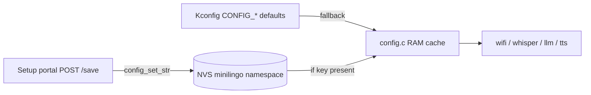

# Subsystem: Config & Provisioning

How MiniLingo gets its settings — Wi-Fi credentials, API keys, model/voice
choices, the active character — and how a user changes them without a PC. Files:
[config.c](../../main/config.c)/[.h](../../main/config.h),
[provisioning.c](../../main/network/provisioning.c),
[wifi.c](../../main/network/wifi.c).

## Two layers: Kconfig defaults + NVS overrides

Settings come from **NVS** (the `minilingo` namespace) with **Kconfig** as the
fallback. `config_init()` (called early in `app_main`) loads each value into a
RAM cache: if the NVS key exists it wins, otherwise the compiled-in
`CONFIG_*` default is used. So a freshly flashed board works from the Kconfig
defaults, and provisioning later overrides them — no re-flash, no code change.

### What's stored

String entries (`s_entries` table in [config.c](../../main/config.c)): Wi-Fi
SSID/password, Groq key, Cerebras key, Gemini key, LLM model, Whisper language,
Gemini voice. Plus an integer **character index** (`config_set_character` /
`config_character_index`, used by the wake-word loader and persona/voice setup).

Getters (`config_wifi_ssid()`, `config_cerebras_key()`, …) replace the old
`CONFIG_*` macros throughout `wifi.c`/`whisper.c`/`llm.c`/`tts.c`; auth headers
are built at runtime (`snprintf("Bearer %s", …)`).

> **Security note:** keys are stored in NVS **in plain text** (as they were in
> the sdkconfig before). Acceptable for this hobby setup; don't ship it as-is.

The Kconfig options themselves live in
[Kconfig.projbuild](../../main/Kconfig.projbuild) and are summarized in
[05-build-and-setup.md](../05-build-and-setup.md).

## Wi-Fi — wifi.c

[wifi.c](../../main/network/wifi.c). Station mode, credentials from the config
cache. A disconnect schedules a reconnect after 5 s via a one-shot `esp_timer`
(don't block the event-loop task). `wifi_is_connected()` (atomic) gates the
cloud pipeline. Connection status is reported via callback → `s_wifi_event` →
the status-bar Wi-Fi icon.

> The ESP32-S3 is **2.4 GHz only** — a 5 GHz SSID fails to associate
> (disconnect reason 201).

## Setup portal — provisioning.c

[provisioning.c](../../main/network/provisioning.c). Tap the Wi-Fi icon (or boot
unprovisioned) → `provisioning_start()`:

1. Brings up a **SoftAP** `MiniLingo-Setup` (WPA2, password `minilingo`) and an
   `esp_http_server`.
2. `GET /` serves a form pre-filled with the non-secret values (SSID, model,
   language, voice); secret fields (password, keys) are blank placeholders.
3. `POST /save` URL-decodes the body and writes each field via
   `config_set_str()` (which updates both NVS and the cache). **Empty secret
   fields keep the old value.** Then it reboots.

> **AP-only during setup.** The ESP has one radio. In APSTA mode the AP must sit
> on the station's channel and kept kicking the setup client (join/leave reason
> 1). So the portal switches to **pure AP mode** for setup; after saving, the
> device reboots and the station connection returns. (This was a real bug — see
> [07-lessons-learned.md](../07-lessons-learned.md).)

The portal is at `http://192.168.4.1`. No TLS on the local portal.

## Character switching

Cycling characters (tap the state text → `on_character_clicked`) writes the new
index to NVS and **reboots**. At boot, `config_character_index()` restores it and
`app_main` sets:

- the **persona** system prompt (`llm_set_system_prompt`,
  [llm.c](../../main/network/llm.c));
- the **TTS voice** (`tts_set_voice`, [tts.c](../../main/network/tts.c));
- the **wake word** (only that character's WakeNet is loaded,
  [afe_pipeline.c](../../main/speech/afe_pipeline.c)).

The `character_t` table (name, idle text, persona, voice) lives in
[main.c](../../main/main.c). Switching reboots because three WakeNets can't be
loaded at once (RAM) — see [speech.md](speech.md) and
[06-design-decisions.md](../06-design-decisions.md).

## Design notes & gotchas

- **"Unprovisioned" = SSID is still the placeholder `"yourwifi"`.** That's the
  trigger for the auto-portal at boot; real Kconfig creds or NVS values count as
  provisioned.
- Changing any setting that a running task already read (Wi-Fi, persona, voice,
  model) takes effect after the reboot the portal/switcher performs — there's no
  live re-read.
